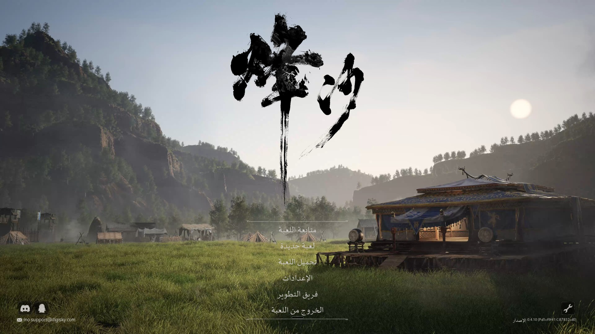
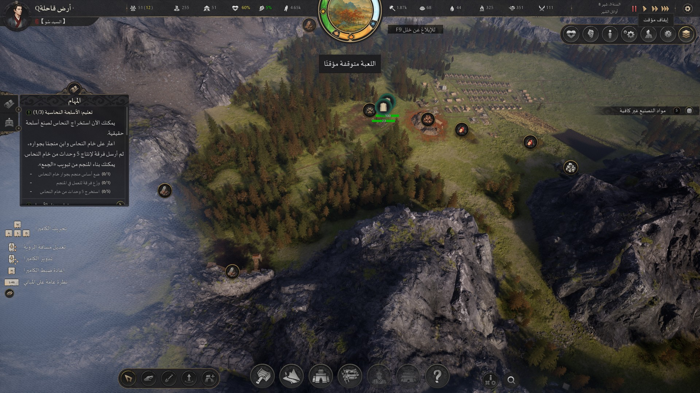
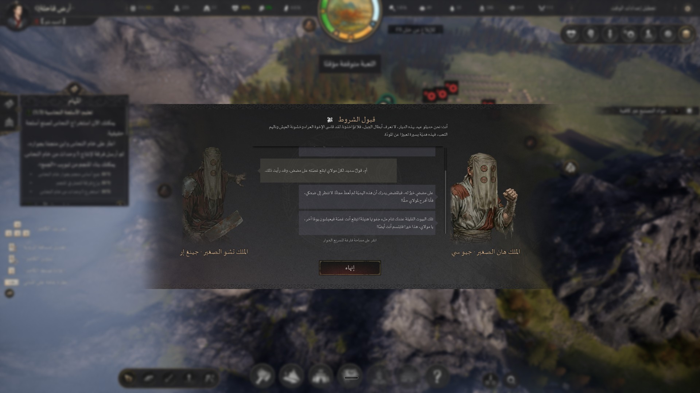
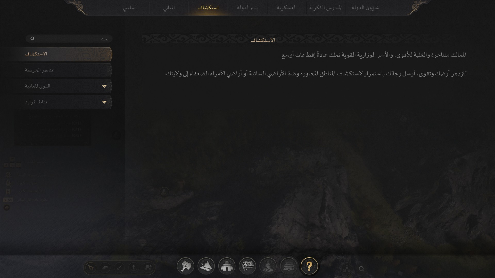

# تعريب Mandate Order (授命)

تعريب كامل ومجاني للعبة Mandate Order بالعربية الفصحى. الإصدار الحالي **1.3.1**، ومطابق لنسخة اللعبة **0.5.0** (تحديث 15 أكتوبر، بناء Steam رقم 25953329).



## التحميل

الملف نفسه في الرابطين، اختر اللي يناسبك:

- **GitHub:** [MandateOrder-Arabic-v1.3.1-manual.zip](https://github.com/qutaiba73/mandate-order-arabic/releases/download/v1.3.1/MandateOrder-Arabic-v1.3.1-manual.zip)
- **Nexus Mods:** [صفحة المود على Nexus](https://www.nexusmods.com/mandateorder/mods/2)

بصمة الملف SHA-256: `d11c58091fc86655d22bb04b6e04d744b7d9d2fe19cdfee30927cfd3a31610f2`

## الجديد في 1.3.1
- لوحة نظرة عامة على المباني (L-Alt): الأسماء صارت متصلة وبالترتيب الصحيح بعد ما كانت مفرّقة ومقلوبة.
- عنوان نافذة الطريق يطلع كامل، و«الأثر:» صارت قبل الجملة.
- شاشة الرتبة: زر «طلب الترقية»، وشرط «الخيمة القيادية» ما عاد مقلوب.
- ملصقات الخريطة العائمة («التقاط»، «إيداع المواد في المخزن») صارت صحيحة.
- ترجمة نصوص تحديث اللعبة في 15 أكتوبر، وتبويب «الإنتاج» في السجن والمعبد، وزر «تفاصيل» في بطاقة القوة.
- تقصير صفوف الترقية اللي كانت تنقص أو تتداخل.
- جربته داخل اللعب على تحديث 15 أكتوبر.

**إذا عندك نسخة قديمة:** نزّل 1.3.1 وانسخ محتويات `files` فوق القديم (الخطوة 4)، وUE4SS ما يحتاج تعيد تثبيته.

## وش يشمل التعريب

**الأقسام المعرّبة:**
- القوائم والإعدادات وواجهة اللعب والتلميحات
- نوافذ المباني، والأحداث، وحوارات القصة
- موسوعة اللعبة كاملة، وقائمة فريق التطوير
- الحروف متصلة والاتجاه صحيح من اليمين لليسار، والأرقام لاتينية (1 2 3)

**ملاحظات مهمة:**
- التعريب يحتاج أداة اسمها UE4SS (مجانية ومفتوحة المصدر). خطوات تنزيلها تحت.
- ما يعدّل ملف exe حق اللعبة، والحزمة ما فيها أي exe أو dll. فيها ملف ترجمة وخط وسكربتات Lua تقدر تفتحها وتقرأها.
- جربته داخل اللعب على نسخة 0.5.0 (تحديث 15 أكتوبر): لوحة المباني (L-Alt)، ونوافذ المباني والترقية، ونافذة الطريق، وشاشة الرتبة، ومخازن السجن، وشاشة التحميل.
- الحفظات القديمة ما تشتغل بعد تحديث اللعبة في 24 سبتمبر، وهذا من اللعبة نفسها مو من التعريب.

---

## طريقة التثبيت خطوة بخطوة

### الخطوة 1: افتح مجلد اللعبة
1. سكّر اللعبة تمامًا.
2. في Steam روح على **Library**، واضغط زر يمين على **Mandate Order**، واختر **Manage** ثم **Browse local files**.
3. بيفتح لك مجلد، هذا هو **مجلد اللعبة**. بتلقى فيه ملف `MOProject.exe` ومجلدين: `Engine` و`MOProject`. خلّ هالنافذة مفتوحة.

### الخطوة 2: ثبّت UE4SS
1. افتح صفحة UE4SS الرسمية: https://github.com/UE4SS-RE/RE-UE4SS/releases
2. نزّل الملف المضغوط اللي اسمه يبدأ بـ **`UE4SS_v3`**. **لا** تنزّل اللي يبدأ بـ `zDEV-`.
   (النسخة اللي جربتها: `UE4SS_v3.0.1-1136-g35d1795d.zip` من إصدار experimental.)
3. فك الضغط. بتلقى داخله ملف **`dwmapi.dll`** ومجلد اسمه **`ue4ss`**.
4. في مجلد اللعبة ادخل **`MOProject`** ثم **`Binaries`** ثم **`Win64`**. لازم تشوف فيه ملف `MOProject-Win64-Shipping.exe`.
5. انسخ **`dwmapi.dll`** ومجلد **`ue4ss`** داخل مجلد `Win64` هذا.

لازم يصير عندك:
```
MOProject\Binaries\Win64\dwmapi.dll
MOProject\Binaries\Win64\ue4ss\
MOProject\Binaries\Win64\MOProject-Win64-Shipping.exe
```

### الخطوة 3: تأكد أن UE4SS شغال
1. شغّل اللعبة من Steam، انتظر لين تطلع القائمة الرئيسية، وبعدين سكّرها.
2. افتح المجلد `MOProject\Binaries\Win64\ue4ss\`. لازم تلقى فيه ملف جديد اسمه **`UE4SS.log`**.
3. إذا ما لقيت `UE4SS.log` معناها UE4SS ما اشتغل. تأكد أن `dwmapi.dll` في نفس المجلد اللي فيه `MOProject-Win64-Shipping.exe`، مو داخل مجلد `ue4ss`. لا تكمل لين يطلع الملف.

### الخطوة 4: أضف ملفات التعريب
1. نزّل ملف `MandateOrder-Arabic-v1.3.1-manual.zip` من قسم [التحميل](#التحميل) فوق.
2. فك ضغط `MandateOrder-Arabic-v1.3.1-manual.zip`. بيطلع لك مجلد اسمه `MandateOrder-Arabic-v1.3.1-manual`.
3. افتحه، وبعدين افتح مجلد **`files`**. بتلقى داخله مجلدين: **`Engine`** و**`MOProject`**.
4. حدد **المجلدين** (`Engine` و`MOProject`) وانسخهم داخل **مجلد اللعبة** اللي فتحته في الخطوة 1، يعني المجلد اللي فيه `MOProject.exe`.
5. Windows بيقول لك إن المجلدات موجودة. اختر **الدمج** أو **Replace the files in the destination**. هذا يضيف ملفات التعريب بس، وما يستبدل أي ملف أصلي من ملفات اللعبة.

بعد النسخ لازم تكون هالملفات موجودة داخل مجلد اللعبة:
```
Engine\Content\Slate\Fonts\NotoNaskhArabicUI-Regular.ttf
MOProject\Content\Localization\Game\ar\Game.locres
MOProject\Binaries\Win64\ue4ss\Mods\ArabicUI\enabled.txt
MOProject\Binaries\Win64\ue4ss\Mods\ArabicUI\Scripts\main.lua
MOProject\Binaries\Win64\ue4ss\Mods\ArabicUI\Scripts\ar_strings.lua
MOProject\Binaries\Win64\ue4ss\Mods\ArabicUI\Scripts\ar_prefix.lua
MOProject\Binaries\Win64\ue4ss\Mods\ArabicUI\Scripts\ar_unshape.lua
```

**غلطة منتشرة:** ناس تنسخ مجلد `files` نفسه، أو مجلد `MandateOrder-Arabic-v1.3.1-manual` كله، داخل مجلد اللعبة. انسخ بس اللي **داخل** `files`.

### الخطوة 5: العب
شغّل اللعبة، وبتفتح بالعربي تلقائيًا. ما تحتاج تغيّر اللغة من الإعدادات، ولا تحتاج تعدّل ملف `mods.txt`.

---

## إذا واجهتك مشكلة
- **اللعبة لسا بالإنجليزي أو الصيني:** تأكد أن `MOProject\Binaries\Win64\ue4ss\Mods\ArabicUI\enabled.txt` والملف `...\ArabicUI\Scripts\main.lua` موجودين بنفس المسارات بالضبط، بدون مجلد زيادة بالنص. وراجع الخطوة 3.
- **الحروف مقطعة أو طالعة مربعات:** تأكد أن الملف `Engine\Content\Slate\Fonts\NotoNaskhArabicUI-Regular.ttf` موجود.
- **اختفى `dwmapi.dll`:** ممكن مضاد الفيروسات أو تحديث اللعبة شاله. هذا الملف تبع UE4SS، نزّله من جديد من صفحة GitHub الرسمية فوق بس.
- **كنت مثبت النسخة القديمة 1.0 (اللي فيها install.bat):** لا تشغّل install.bat القديم. أول شي رجّع ملف اللعبة الأصلي: في Steam اضغط زر يمين على **Mandate Order** واختر **Properties** ثم **Installed Files** ثم **Verify integrity of game files**. بعدها اتبع الخطوات فوق.

## الإيقاف والإزالة
- **توقف التعريب مؤقتًا:** احذف الملف `enabled.txt` من `MOProject\Binaries\Win64\ue4ss\Mods\ArabicUI\`.
- **تشيل التعريب كله:** احذف هالثلاثة:
```
MOProject\Binaries\Win64\ue4ss\Mods\ArabicUI\
MOProject\Content\Localization\Game\ar\
Engine\Content\Slate\Fonts\NotoNaskhArabicUI-Regular.ttf
```
  إذا عندك مودات ثانية تحتاج UE4SS خلّه. وإذا تبي تشيله بعد، احذف `dwmapi.dll` ومجلد `ue4ss` من `MOProject\Binaries\Win64\`.

## بعد تحديث اللعبة
التعريب ما يعدّل ملف exe حق اللعبة. إذا التحديث أضاف نصوص جديدة، ممكن تطلع بدون ترجمة لين أحدّث التعريب.

## بلّغ عن مشكلة
إذا شفت نص صيني أو حروف مقطعة، افتح [Issue](https://github.com/qutaiba73/mandate-order-arabic/issues) وحط صورة مع اسم الشاشة.

## صور

| واجهة اللعب | حوار القصة | الموسوعة |
|---|---|---|
|  |  |  |

## الرخص

- خط Noto Naskh Arabic تحت رخصة SIL OFL 1.1 ([licenses/OFL-NotoNaskhArabic.txt](licenses/OFL-NotoNaskhArabic.txt)).
- UE4SS ليس جزءًا من هذا التعريب، وتنزّله من مصدره الرسمي.
- الحزمة ما فيها أي ملف من ملفات اللعبة الأصلية.